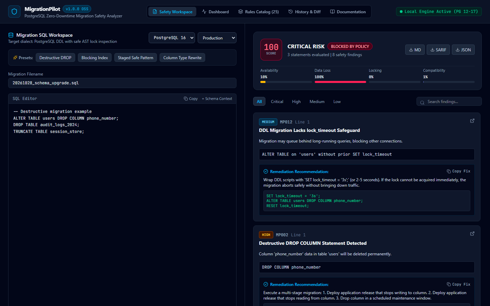
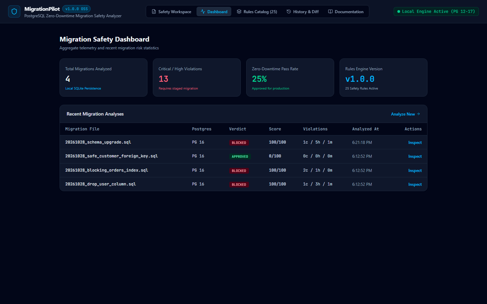
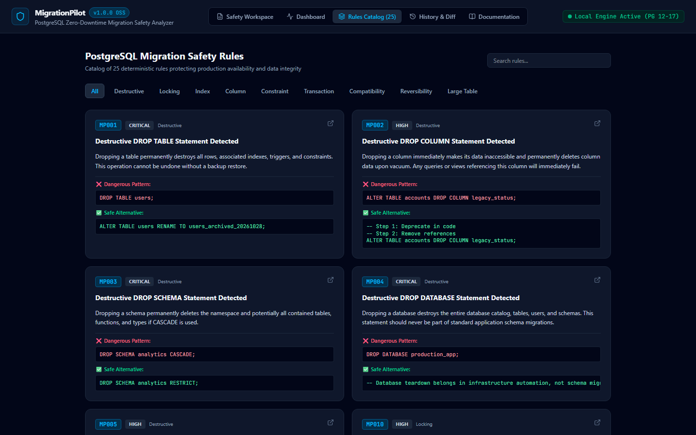
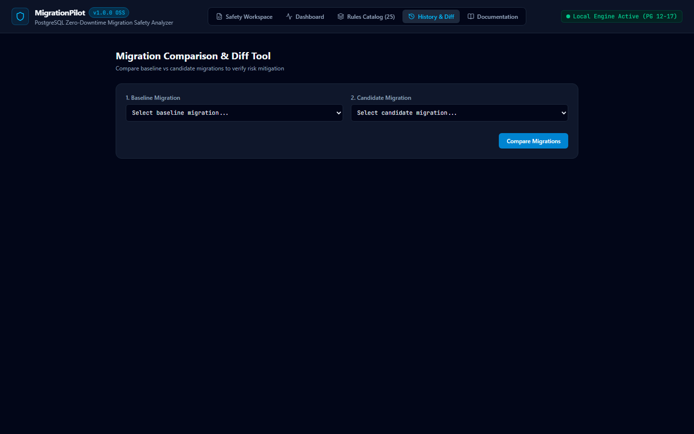

# 🛡️ MigrationPilot

> **Production-grade PostgreSQL Migration Safety Analyzer & Zero-Downtime Linting Engine**

[](LICENSE)
[](packages/analyzer/tests/analyzer.test.ts)
[](https://www.postgresql.org)
[](package.json)
[](.github/workflows/migration-safety.yml)

MigrationPilot helps backend developers, platform engineers, and DBAs catch dangerous PostgreSQL schema migrations **before** they reach production. It statically parses PostgreSQL DDL into structured ASTs, detects table locks, rewrites, and blocking constraints, explains the underlying engine risk, and generates safe, copyable zero-downtime SQL alternatives.

---

## 📸 Platform Screenshots

### 1. Safety Analysis Workspace
*Interactive two-panel SQL analysis with real-time risk scoring, policy evaluation, dimension meters, and actionable safe remediation snippets.*


### 2. Migration Safety Dashboard
*High-level telemetry tracking migration risk scores, violation counts, zero-downtime pass rates, and persisted analysis history.*


### 3. Rules Catalog & Knowledge Base
*Deep architectural explanations, official PostgreSQL documentation references, and dangerous vs safe code examples for all 25 rules.*


### 4. Migration History & Diff Tool
*Side-by-side comparison of baseline vs candidate migrations with risk score deltas.*


---

## 📦 Repository Details

| Metric / Attribute | Specification |
|---|---|
| **Repository Name** | `migrationpilot` |
| **Owner / Maintainer** | [`0xyz-exe`](https://github.com/0xyz-exe) |
| **Repository URL** | [https://github.com/0xyz-exe/migrationpilot](https://github.com/0xyz-exe/migrationpilot) |
| **Visibility** | Public (Open Source) |
| **License** | [Apache License 2.0](LICENSE) |
| **Default Branch** | `main` |
| **Core Engine** | TypeScript 5.7+ (`pgsql-ast-parser`, Vitest) |
| **Web UI & API** | React 19, Tailwind CSS v4, Vite 6, Node 26 `node:sqlite` |
| **CLI Binary** | `@migrationpilot/cli` (`migrationpilot`) |
| **PostgreSQL Targets** | PostgreSQL 12, 13, 14, 15, 16, 17 |
| **Clone (HTTPS)** | `git clone https://github.com/0xyz-exe/migrationpilot.git` |
| **Clone (SSH)** | `git clone git@github.com:0xyz-exe/migrationpilot.git` |
| **Issues & Requests** | [https://github.com/0xyz-exe/migrationpilot/issues](https://github.com/0xyz-exe/migrationpilot/issues) |
| **Pull Requests** | [https://github.com/0xyz-exe/migrationpilot/pulls](https://github.com/0xyz-exe/migrationpilot/pulls) |
| **Security Reporting** | [SECURITY.md](SECURITY.md) |

---

## ✨ Key Features

- **Real PostgreSQL AST Parsing:** Powered by `pgsql-ast-parser` with lexical token and regex fallback for dialect edge cases.
- **25 Deterministic Safety Rules:** Covers 10 distinct failure domains:
  - **Group A (Destructive):** `DROP TABLE`, `DROP COLUMN`, `DROP SCHEMA`, `DROP DATABASE`, `TRUNCATE`.
  - **Group B (Locking):** `ACCESS EXCLUSIVE` table lock escalation, table rewrites, missing `lock_timeout`.
  - **Group C (Indexes):** Non-concurrent index builds, invalid `CONCURRENTLY` inside explicit `BEGIN...COMMIT` transactions.
  - **Group D (Columns):** `SET NOT NULL` full table scans, lossy column type conversions, default drops.
  - **Group E (Constraints):** Adding `FOREIGN KEY` or `CHECK` constraints without `NOT VALID`.
  - **Group F (Transactions):** Disallowed statements (`VACUUM`, `CREATE INDEX CONCURRENTLY`), long multi-statement DDL transactions.
  - **Group G (Compatibility):** PostgreSQL 11-17 default rewrites and column storage behaviors.
  - **Group H (Dependencies):** Target tables or referenced relations missing from schema context.
  - **Group I (Reversibility):** Irreversible operations lacking backward-compatible rollbacks.
  - **Group J (Large Tables):** Risk amplification for tables with >100,000 rows or large disk footprints.
- **Explainable 0–100 Risk Scoring:** Transparent formula evaluating Availability, Data Loss, Lock Contention, and Compatibility dimensions.
- **Actionable Remediation Engine:** Every warning provides ready-to-run zero-downtime replacement SQL (e.g. `NOT VALID` followed by asynchronous `VALIDATE CONSTRAINT`).
- **CLI & CI/CD Tooling:** Deterministic terminal output, SARIF v2.1.0 generation for GitHub Code Scanning, and configurable failure thresholds (`--fail-on high`).
- **Local-First & Offline:** 100% offline static analysis. No external LLMs, no third-party APIs, and zero live database execution.
- **Built-in Persistence:** Uses Node 26's native `node:sqlite` for fast local analysis history without extra database setup.

---

## 🚀 Quickstart

### Prerequisites

- **Node.js:** `>= 20.0.0`
- **pnpm:** `>= 9.0.0` (or `npm`)

### 1. Installation

```bash
git clone https://github.com/0xyz-exe/migrationpilot.git
cd migrationpilot
pnpm install
pnpm build
```

### 2. Start the Web Workspace

```bash
pnpm --filter @migrationpilot/web build
node apps/web/server.js
```
Open **[http://127.0.0.1:3080](http://127.0.0.1:3080)** in your browser.

---

## 💻 CLI Usage

The MigrationPilot CLI can inspect single SQL files or entire migration folders:

```bash
# 1. Analyze single migration
node packages/cli/bin/migrationpilot.js analyze ./examples/01_destructive_migration.sql

# 2. Analyze safe zero-downtime migration
node packages/cli/bin/migrationpilot.js analyze ./examples/03_safe_migration.sql

# 3. Export SARIF for GitHub Code Scanning
node packages/cli/bin/migrationpilot.js analyze ./examples --format sarif --output migrationpilot.sarif --fail-on high

# 4. Export Markdown report
node packages/cli/bin/migrationpilot.js analyze ./examples/01_destructive_migration.sql --format markdown --output report.md

# 5. List all registered safety rules
node packages/cli/bin/migrationpilot.js rules list

# 6. Deep explanation of a specific rule
node packages/cli/bin/migrationpilot.js rules explain MP020
```

### CLI Exit Codes

| Exit Code | Meaning |
|---|---|
| `0` | Analysis passed; no findings exceeding configured failure threshold. |
| `1` | Analysis failed; findings exceeded threshold (e.g. Critical or High). |
| `2` | Configuration error or invalid input path. |
| `3` | Internal engine error. |

---

## 🏛️ Monorepo Architecture

```
migrationpilot/
├── apps/
│   └── web/                   # Vite + React 19 UI & REST API server (Node :sqlite)
├── packages/
│   ├── analyzer/              # Core AST parser, 25 rules, risk scorer, reports
│   └── cli/                   # Node executable CLI binary (migrationpilot)
├── docs/                      # Architectural specs, rule docs, and screenshots
│   ├── architecture.md
│   ├── analyzer-rules.md
│   ├── risk-scoring.md
│   ├── security.md
│   ├── cli.md
│   ├── api.md
│   ├── postgres-compatibility.md
│   ├── limitations.md
│   └── screenshots/           # Real UI captures
├── examples/                  # Safe & unsafe migration test fixtures
├── .github/workflows/         # CI and SARIF pull request scanning
├── Dockerfile                 # Self-contained container definition
├── docker-compose.yml         # Containerized production deployment
└── README.md
```

---

## 🧪 Automated Verification & Tests

Run the test suite across all packages:

```bash
# Run unit tests (14 passing tests)
pnpm test

# Build all TypeScript packages
pnpm build

# Build web frontend
pnpm --filter @migrationpilot/web build
```

---

## 🐳 Docker Deployment

Run MigrationPilot in an isolated container:

```bash
docker compose up -d --build
```
Access the application at `http://localhost:3080`.

---

## 🤝 Contributing

We welcome community contributions, additional PostgreSQL rules, and optimizations! Please read [CONTRIBUTING.md](CONTRIBUTING.md) and our [CODE_OF_CONDUCT.md](CODE_OF_CONDUCT.md) before opening a PR.

---

## 📄 License

Distributed under the **Apache License 2.0**. See [LICENSE](LICENSE) for details.
